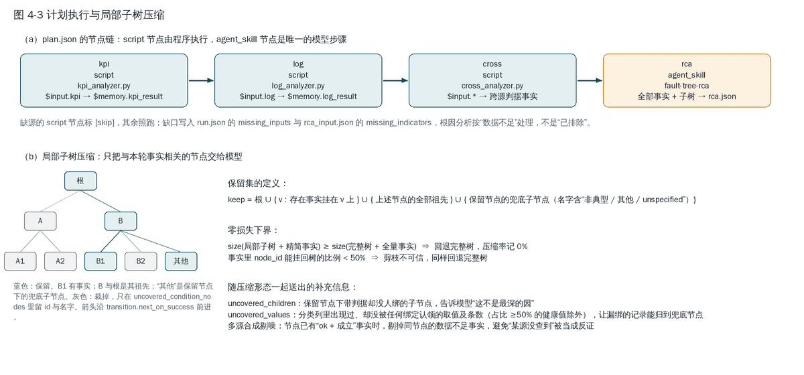
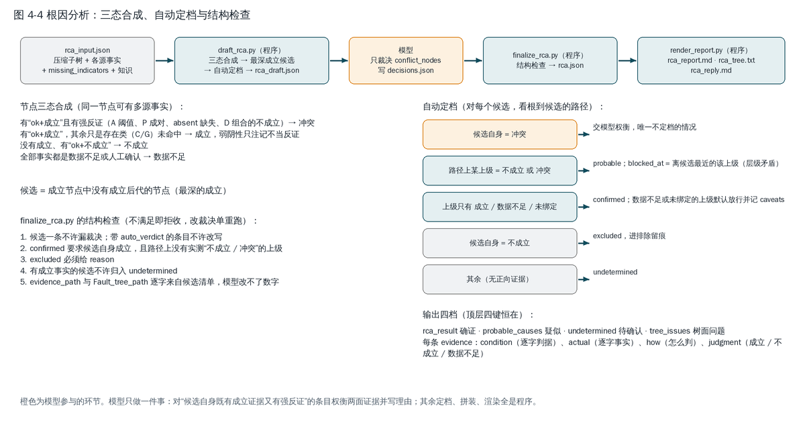
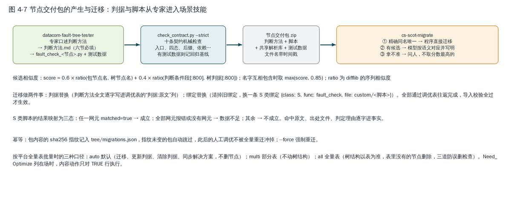
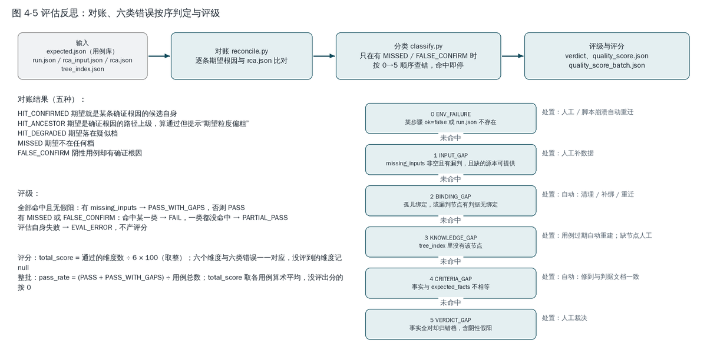
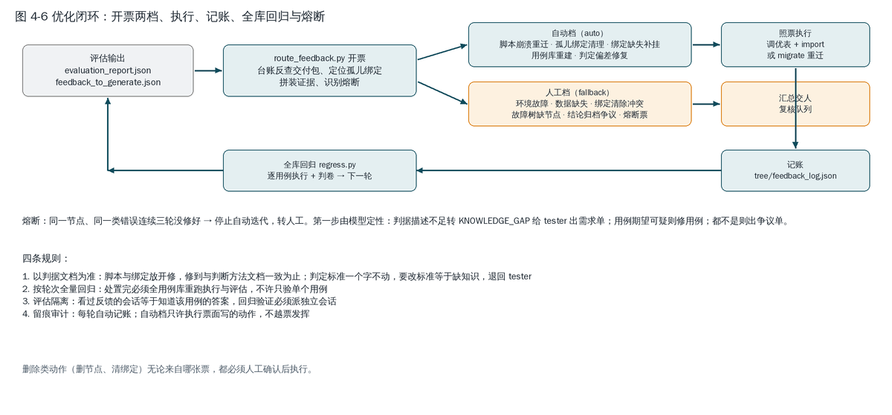

# 4 算法设计

> 本章按当前实现（仓库 `skills/` 下七个技能）重写。代码片段与字段名以仓库为准；数字类占位用方括号标出，按实际填写。插图在 `docs/算法设计说明书-图/` 目录。

## 4.1 总体设计

### 4.1.1 设计理念：计算与判断分离

故障排查被拆成两类性质不同的工作，分别交给程序和模型。

**确定性计算交给程序。** 故障树判据落到数据层面后，计算种类相当收敛：阈值比较、字段或日志匹配、缺失性检查、多条件组合、两端取值比对。这些计算由经过测试的内核库完成，执行快、结果精确、可以给出机械的判定依据，例如"接口状态列命中 Down 的行数 = 3，要求至少 1 行，判定成立"。

**语义判断交给模型。** "接入成功率偏低"这条判据对应数据里的哪一列，该用阈值比较还是占比统计，"未配置桥 MAC"是缺行才算故障还是有行才算故障，这类语义映射与算法选择由模型完成，而且只在生成阶段做一次，写成结构化的绑定，此后每次执行都不再需要模型。

**根因判定尽量机械化。** 候选如何定档、证据如何拼装、报告如何渲染，都由程序按固定规则完成；模型只在"候选自身既有成立证据又有强反证"这一种情况下权衡两面证据。

### 4.1.2 Skill 飞轮：四个环节、七个技能

一次性萃取的技能质量无法保证，所以在生成之外又建了执行、评估、优化三个环节，形成闭环。四个环节由七个技能承担，见图 4-1。


图 4-1 Skill 飞轮总体架构

| 环节 | 技能 | 性质 | 输入 | 输出 |
|---|---|---|---|---|
| 生成 | cs-scot-generate | 程序为主，模型做绑定 | 故障树 xlsx、各指标数据 | 场景技能：plan.json、逐条件分析脚本、树索引、调优表 |
| 执行 | cs-scot-execute | 确定性程序 | 场景技能、采集数据 | 本轮结果目录：run.json、rca_input.json |
| 执行 | fault-tree-rca | 程序定档，模型裁决冲突 | rca_input.json | rca.json、三份报告 |
| 评估 | cs-scot-reflect | 确定性程序 | 结果目录、用例库 | evaluation_report.json、评分、反馈 |
| 优化 | cs-scot-generate-optimize | 程序开票，模型照票执行 | 评估输出、场景技能 | 更新后的场景技能、记账文件 |
| 优化 | cs-scot-migrate | 确定性程序 | 节点交付包、对应表 | 判据与绑定替换后的场景技能、迁移记录 |
| 输入侧 | datacom-fault-tree-tester | 模型与专家交互 | 专家口述的判断方法、测试数据 | 节点交付包 zip |

表 4-1 环节与技能

两个辅助技能不在环上：zip2csv 把原始采集文本转成三张表，fault-tree-rca-debate 是与 fault-tree-rca 接在同一位置、可互换的辩论引擎。

环节之间以结构化文件衔接，不传自然语言。模型介入的位置只有五处，其余全是程序：

1. 生成阶段判断每条判据归哪个数据源（分派）；
2. 生成阶段为每条判据填写绑定；
3. 根因分析阶段裁决冲突候选；
4. 迁移阶段在候选列表里按语义确认"包里的节点与树上的节点是不是同一个故障"；
5. 优化阶段照票执行修改。

### 4.1.3 场景技能：唯一被反复修改的资产

飞轮每转一圈，改的都是同一个东西：场景技能目录。它的结构如下，后文各环节的读写都以此为准。

```
<场景技能>/
├── SKILL.md                      # 执行指引（cs-scot-execute 的正文改名而来）
├── scripts/runner.py             # 执行器；check_data.py 数据入口检查；tree_prune.py 压缩
└── assets/                       # 产物目录 <OUT>
    ├── plan.json                 # SCoT 执行计划
    ├── manifest.json             # 格式契约版本、生成时间
    ├── scripts/<指标>_analyzer.py  # 逐条件分析脚本，CONDITIONS 列表是绑定
    ├── scripts/cross_analyzer.py  # 跨源判据（传参链、两侧比较）
    ├── scripts/custom/           # 迁入的节点判断脚本 fault_check_*.py
    ├── scripts/condition_kernels.py  # 内核库副本
    ├── tree/<短名>.tree_index.json   # 权威拓扑：node_id、父子、判据、数据源
    ├── tree/<短名>.tuning.xlsx       # 调优表：人可编辑的事实源
    ├── tree/migrations.json      # 迁移记录
    ├── tree/feedback_log.json    # 优化记账
    ├── tree/knowledge.md         # 外挂判读规则
    └── fault-tree-rca/           # 根因分析规则与脚本副本
```

树索引里每个节点的形态：

```json
"n16": {"name": "V-STP根桥未配置桥MAC", "parent": "n12", "level": 4,
        "code": "L4-03", "children": [],
        "condition": "检查配置是否有 stp v-stp enable，回显 display stp 是否为根桥……",
        "combine": "AND", "data_source": "配置数据判断方法",
        "pass_through": false}
```

`node_id` 形如 `n16`，是全链路的主键：绑定靠它把事实挂回树，根因分析靠它回溯路径，评估靠它对账，迁移靠它定位。

## 4.2 生成算法（cs-scot-generate）

### 4.2.1 目标与步骤

输入一棵故障树 xlsx 和若干指标的数据，输出该场景的诊断技能。分六步，见图 4-2。


图 4-2 诊断技能生成算法

| 步骤 | 脚本 | 做什么 | 模型是否参与 |
|---|---|---|---|
| 1 建树 | excel_to_tree_v2.py | 从母表截取场景子树，产出 tree_index.json 与故障树 Markdown | 否 |
| 2 组装 | assemble_scenario.py | 复制内核库，为每个指标生成空白分析脚本，生成 plan.json | 否 |
| 2.5 绑定 | make_dispatch.py、merge_conditions.py | 把判据分批派给子代理并行绑定，合并写入 CONDITIONS | 是 |
| 3 验证 | validate_conditions.py、check_tree_coverage.py | 用真实数据跑脚本，检查绑定质量与叶子覆盖度 | 否 |
| 4 清理 | 删除 overview/、dispatch/ | 去掉带真实数据样本的中间文件 | 否 |
| 5 打包 | package_scenario.py | 只在步骤 1 没能直接生成技能目录时执行 | 否 |

表 4-2 生成步骤

### 4.2.2 建树：从母表到权威拓扑

母表每一行是根到某节点的路径，判断条件挂在最深节点上。建树脚本按 `--start-node` 截取子树，为每个节点分配稳定的 `node_id`，记录父子关系、AND/OR 提示与数据源标签。

两条规则值得说明。

**高层节点不参与判定。** L1、L2 带判据的节点和场景根节点自动标记 `pass_through`。这些层的判据多为"场景分类、选路、参考下级节点"之类的说明，不是故障条件；把它们绑成判定会让整棵树的确证卡在高层。确实要在高层判定时加 `--bind-top-levels`。

**判据按数据源预分派。** 新格式母表按数据源分列（CHR、配置、日志、信令等），建树时把列名写入节点的 `data_source`，步骤 2.5 据此决定判据进哪个数据源的批次；没有按源分列的判据归"通用"标签，由模型读判据原文决定归属。

### 4.2.3 组装：执行计划与外挂知识

组装脚本生成 plan.json，它是 SCoT v4.0 的子集：节点列表加转移关系，节点分 `script` 与 `agent_skill` 两种。

```json
{
  "version": "4.0",
  "entry": "kpi",
  "memory_init": {"fault_tree_md": "tree/SA场景接入失败.md"},
  "nodes": [
    {"id": "kpi", "kind": "script", "name": "kpi_analyzer",
     "inputs": {"data": "$input.kpi"},
     "outputs": {"result": "$memory.kpi_result"},
     "transition": {"next_on_success": "chr"}},
    {"id": "chr", "kind": "script", "name": "chr_analyzer",
     "inputs": {"data": "$input.chr"},
     "outputs": {"result": "$memory.chr_result"},
     "transition": {"next_on_success": "rca"}},
    {"id": "rca", "kind": "agent_skill", "name": "fault-tree-rca",
     "inputs": {"fault_tree_md": "$memory.fault_tree_md",
                "kpi": "$memory.kpi_result", "chr": "$memory.chr_result"},
     "outputs": {"result": "$output.final_answer"},
     "transition": {"end": true}}
  ]
}
```

计划是直线的：故障树的分支判断在根因分析内部完成，执行层只顺序遍历。有跨源判据时，各指标脚本之后会多一个 `cross` 节点，它的 `inputs.data` 是 `$input.*`，执行器把本轮全部数据源都递给它。

外挂知识分两级。技能级 `knowledge.md` 是跨场景积累的出厂知识，首次组装时复制进产物；产物级 `tree/knowledge.md` 由业务同事在交付后追加，重跑组装不覆盖。每条知识是一段，`### 标题` 开头，可带 `阶段:绑定/诊断` 和 `适用:标签`。绑定任务说明和根因分析输入按"适用"标签与节点名、判据文本匹配后自动载入。知识是判读规则不是事实：它教系统去哪查、怎么解读、什么算正常，成立与否仍以数据为准。

### 4.2.4 绑定：判据到数据列的结构化映射

这一步是生成算法的核心，也是模型唯一大量参与的地方。目标是为每个 `<指标>_analyzer.py` 填好 `CONDITIONS` 列表，每条判据一个绑定。

**判断类别。** 内核库把判据归为六类，另有一类由迁移产生：

| 代号 | 类别 | 典型判据 | 关键参数 | 产出事实 |
|---|---|---|---|---|
| A | 阈值比较 | 接入成功率 < 99% | column、op、threshold、scope（aggregate / count_rows）、agg | aggregate 给 value；count_rows 给 count_satisfied、ratio |
| C | 字段匹配 | 释放原因为 RNL_Unspecified | column、equals / contains / regex、require、absent | matched、total、ratio、top、hits |
| G | 日志匹配 | 日志含告警码 ALM-26529 | 同 C | 同 C |
| D | 多条件组合 | A 且 B，A 或 B | combine、sub、group_by | 按三态合成规则给出 |
| P | 成对比较 | 本端与对端桥 MAC 不一致 | side_column、value_column、fault_when、pair_from | local、peer、equal |
| J | 人工确认 | 需现场确认 | note | status 为 manual，不给判断 |
| S | 节点判断脚本 | 迁入的 fault_check 脚本 | func、file、args | 脚本返回的四态映射为三态 |

表 4-3 判断类别与内核

早期版本的 B 差值、E 占比、F 配置检查、H 信令流程、I 特征分析五类已封存，数通场景的判据普查中零命中；原用途由 A 的 count_rows、C 的 extract 等覆盖。

**一条绑定的形态。** 以"V-STP 根桥未配置桥 MAC"为例，这是一条跨源的组合判据：

```python
{"id": "L4-03", "node": "V-STP根桥未配置桥MAC", "node_id": "n16",
 "condition_text": "检查配置是否有 stp v-stp enable，回显是否为根桥，配置的桥MAC是否与回显一致",
 "class": "D", "source": "config", "combine": "AND",
 "mapping_reason": "判据三个要件分别落在配置表 level1 列、回显表 CmdResult 列",
 "sub": [
   {"class": "G", "source": "config", "column": "level1", "contains": ["stp v-stp enable"]},
   {"class": "G", "source": "cmd", "column": "CmdResult",
    "filter": {"column": "CmdName", "contains": "display stp"},
    "contains": ["This bridge is the root"]},
   {"class": "D", "combine": "OR", "source": "config", "sub": [
      {"class": "G", "source": "config", "column": "level1",
       "contains": ["stp bridge-address"], "absent": True},
      {"class": "P", "source": "config", "fault_when": "not_equal", "pair_from": {
         "local": {"source": "config", "column": "level1",
                   "filter": {"column": "level1", "contains": "stp bridge-address"},
                   "extract": {"regex": "stp bridge-address ([0-9a-fA-F-]+)"}},
         "peer": {"source": "cmd", "column": "CmdResult",
                  "filter": {"column": "CmdName", "contains": "display stp v-stp"},
                  "extract": {"regex": "Active=([0-9a-fA-F-]+)"}}}}]}]}
```

公共字段里有三个是设计上的关键：`condition_text` 逐字取自故障树，供根因分析复核；`mapping_reason` 写明为何这样对应、语义或单位有何差异，让人可以审计；`decision` 在模型判定本条无法机械评估时填 `insufficient_data` 或 `manual`，直接出该状态、不跑内核，比硬凑一个绑定更诚实。

两个横切能力让绑定能处理真实数据的形态：`filter` 做行级预过滤，先把行缩到某条命令或某个检查项的子集；`extract` 做格内取值，从"利用率:83%,速率:1G"这样的杂糅文本里抽出要的那一段。抽不到按缺测计，不当不命中。

**内核的三态语义。** 每条绑定跑出一个事实，`predicate_satisfied` 是仅在解析到的列上做的字面比较，`status` 说明这次算没算成：

- `status = ok`，`predicate_satisfied = true`：数据在，查了，命中；
- `status = ok`，`predicate_satisfied = false`：数据在，查了，没命中；
- `status = insufficient_data`：列不存在、列全空、过滤后零行、正则编译失败、参数抽不到或歧义，都归此类，附 reason。

以 C/G 类为例，内核对每一行做匹配，统计命中行数 matched、纳入统计的非空行数 total、占比 ratio、同列取值分布 top，并截取命中处的原文片段 hits 供证据引用。判定规则：

```
predicate_satisfied = (matched == 0)        当 absent 为真（缺行即故障）
predicate_satisfied = (matched >= require)  否则，require 默认 1
```

`absent` 为真而整列无值时不判成立：缺的可能是导出段而不是配置。A 类在 aggregate 模式下对列做聚合（mean、min、max 等）再与阈值比较，在 count_rows 模式下逐行比较、统计满足行数并与 require 比较。

D 类的三态合成：

| combine | 任一子条件 false | 否则，任一子条件数据不足 | 否则 |
|---|---|---|---|
| AND | false | 数据不足 | true |
| OR | true（任一子条件 true 时） | 数据不足 | false |

表 4-4 AND/OR 三态合成

带 `group_by` 时按对象列切组，每组单独跑全部子条件，任一组全真才成立，用于"配了 A 但没配 B，且发生在同一接口上"这类判据。

**参数化查询。** 有的判据一步查不完，要先查出一个值再拿它当参数查下一处。绑定里用 `param_from` 声明参数从哪抽，查询体用 `@参数名` 占位：

```python
{"class": "G", "source": "config", "column": "level2",
 "contains": ["mode lacp-static"], "absent": True,
 "filter": {"column": "level1", "equals": "@plink"},
 "param_from": {"plink": {"source": "cmd", "column": "CmdResult",
                          "filter": {"column": "CmdName", "contains": "peer-link"},
                          "extract": {"kv": "Port Name"}}}}
```

参数按声明顺序解析，后面的可引用前面的，只能向前引用，天然无环。参数抽不到或抽出多个不同值都判数据不足；查询里用了 `@xxx` 却没声明则拒收，否则拿字面的 `@` 去匹配会恒不命中，等于假排除。`expand` 让一个参数逐值展开，要求全部满足或任一满足，展开上限 32 个。跨源判据统一写进 `cross_analyzer.py`。

**并行派发。** 一棵树几十到上百条判据，单个会话逐条做既慢又容易在长上下文里出错，所以分批交给子代理并行。任务说明由脚本生成而不是模型写，原因有三：概览和枚举原文要原样嵌入，模型转述会删减；公共规约是固定文本，脚本每次一致；绑定内容不经过主会话上下文，子代理直接把结果写成文件，主代理只跑合并脚本。六个动作：

1. 概览：`analyzer.py --lean` 统计每个数据源的列名、极值、类别取值；
2. 分派：`make_dispatch.py --route` 生成分派任务说明，一个子代理判断每条判据可能归哪些源，宁多勿漏；
3. 生成任务说明：每个数据源按批切分，默认每批不超过 12 条，嵌入该源的概览与规约；
4. 派发：一份任务说明派一个子代理，每轮最多 8 个；
5. 合并：`merge_conditions.py` 验收（可解析、无乱码、C/G 类有 contains 或 equals、有 node_id）、去重、写入各脚本的 CONDITIONS；
6. 跨源补绑：合并脚本报出跨源候选时，`make_dispatch.py --cross` 生成补绑任务说明，结果写进 cross_analyzer.py。

分批的好处是并行度：66 条判据 18 份任务说明，每轮 8 个子代理只要 3 轮。

**绑定质量的机械约束。** 绑定只取决于数据格式与判据语义，不受单次数据偶然取值影响，这样产物才能一次生成、同场景反复执行。生成阶段贯彻一条反替代原则：判据要的量在数据里对不上时，标数据不足，不得拿一个相关的、近乎恒成立的列顶替。步骤 3 的 `validate_conditions.py` 机械识别三类典型错误：以总成功率替代特定子原因、多条判据绑到同一列、以高频通用取值替代特定信号。`check_tree_coverage.py` 按树遍历，列出没被任何绑定认领的叶子；判据提到已提供的列却没绑，退出码 1。

覆盖度的定义：

```
覆盖度 = 已被某个数据源绑定的应绑叶子数 ÷ 树上应绑的叶子数
应绑叶子 = 带判据、非 pass_through 的叶子节点
```

### 4.2.5 调优表：树与绑定的可编辑事实源

打包时导出 `tree/<短名>.tuning.xlsx`：单页签，一行一个节点，含层级、判据原文、各数据源的绑定 JSON、解决方案。人改完表后一条命令编译回产物，零模型参与：

```bash
python "<产物>/scripts/import_tree_excel.py" --out "<产物目录>"
```

导入先全量校验再写盘：JSON 损坏、编号重复、上级不符都按 Excel 行号报错，一个文件不动。`node_id` 只认不改，新行留空自动分配，历史编号不复用。导出调优表之后，树与绑定的一切修改只在调优表上做，迁移、优化、增删节点都走这条通道，复用它的全部校验。

## 4.3 执行算法（cs-scot-execute）

### 4.3.1 计划执行模型

执行器从 `entry` 节点出发，用 `memory_init` 初始化工作记忆，按节点 `kind` 分派，沿 `transition.next_on_success` 前进，`end` 为真时结束。节点间的数据全靠四种引用表达式传递：`$input.<指标>` 指命令行 `--data <指标>=<文件>` 提供的数据，`$memory.<路径>` 指工作记忆，`$step.<id>.<字段>` 指某节点的产出，`$output.<路径>` 指最终输出。

`script` 节点运行 `scripts/<name>.py <数据> -o <临时文件>`，把 JSON 产出按 `outputs` 写入工作记忆。`agent_skill` 节点把解析好的输入写到本轮结果目录的 `rca_input.json`，交给 fault-tree-rca。未定义的 `kind` 直接报错，不静默跳过。

### 4.3.2 运行管理

每次运行自动新建 `result-[标签-]<运行号>/`，运行号是时间戳加随机数，并发和重跑都不会重复。每轮写 `run.json`：

```json
{"run_id": "20260918T090000Z-1a2b3c",
 "inputs": {"cmd": {"path": "…/cmd.csv", "size": 1048576, "sha1": "…"},
            "config": {"path": "…", "size": 0, "sha1": "…"}},
 "missing_inputs": ["log"],
 "missing_kind": {"log": "collection_absent"},
 "execution_status": {"cmd": {"ok": true}, "config": {"ok": true},
                      "log": {"skipped": "数据源未提供"}, "rca": {"ok": true}}}
```

输入指纹让评估阶段能把结果目录与用例对上号；`execution_status` 每步跑完立即写入，半途失败时已跑步骤的状态也在账上。

部分数据也能跑：计划需要的数据源只给了一部分时不报错，缺源的解析步骤标 `[skip]`，缺口写进 `run.json` 的 `missing_inputs` 和 `rca_input.json` 顶层的 `missing_indicators`，根因分析把这些源绑定的判据按"数据不足"处理，不是"已排除"。`missing_kind` 区分两种缺口：`collection_absent` 表示采集本身不含该类内容，`not_provided` 表示没喂；评估归因据此决定算不算数据缺失。

启动时比对产物 `manifest.json` 的格式契约版本，较旧或缺失只告警不阻断。

### 4.3.3 局部子树压缩

真实故障树常有上百个节点，单次故障相关的只有十几个。执行完各脚本后，`tree_prune.py` 把树裁成局部子树再交给模型，见图 4-3。



图 4-3 计划执行与局部子树压缩

保留集的定义：

```
keep = {root}
     ∪ {v | 有事实挂在 v 上}
     ∪ {u | u 是上述某节点的祖先}
     ∪ {c | c 是某保留节点的子节点，且名字或判据含"非典型 / 其他 / unspecified / unknown"}
```

最后一项保留兜底节点，是为了绑定漏绑某一支时，根因分析仍能据原始事实把记录归到一个真实节点上。随压缩形态一起送出的还有三样：`uncovered_children`，保留节点下带判据却没人绑的子节点，告诉模型"这不是最深的因"；`uncovered_values`，分类列里出现过却没被任何绑定认领的取值及条数，占比不低于 50% 的健康值除外；多源合成剔噪，节点已有"ok + 成立"事实时，剔掉同节点的数据不足事实，避免"某源没查到"被当成反证。

压缩带零损失下界：

```
若 size(局部子树 + 精简事实) ≥ size(完整树 + 全量事实)：回退完整树，压缩率记 0%
若 事实里能挂回树的 node_id 比例 < 50%：剪枝不可信，回退完整树
否则：压缩率 = 1 − size(局部子树) ÷ size(完整树)
```

小而密的树本就无可剪，回退保证不产生负优化。实测一棵 [320] 节点的树可裁到约 [19] 个节点。

### 4.3.4 数据入口与引擎选择

场景技能形态下用户只说一句"数据在这里，帮我诊断"。执行指引规定第 0 步先跑 `check_data.py`，机械判定数据形态并给出建议喂法：已解析的表直接喂；原始日志目录（网元目录下有 CONFIG、CMD、LOG 子目录）先用 `assets/zip2csv/scripts/zip2csv.py` 转成三张表，再连同原始目录用 `--data raw=<目录>` 一起喂，S 类脚本直接读原始文件；零散的原始文件同样喂给 zip2csv，它先归类再转表。退出码 2 表示结构不认识，把报告原样给用户，不强行继续。

根因分析引擎由环境变量 `SCOT_DEBATE` 选择：未设置或 `off` 走 fault-tree-rca；`auto` 在候选清单里有争议候选时找辩论引擎，找不到或缺依赖则明说并走标准路径；`force` 直接全树辩论。交付出去的场景技能不带辩论引擎。

## 4.4 根因分析算法（fault-tree-rca）

### 4.4.1 目标与三步

把各指标解析好的事实和故障子树放在一起判定根因。本技能与指标种类无关。三步完成，见图 4-4：

1. `draft_rca.py` 读 rca_input.json，生成候选清单 `rca_draft.json`：所有成立节点列成候选，根到候选的路径和证据预填，每个候选自动定档；
2. 只有清单里存在冲突候选时，模型写裁决单 `decisions.json`，一个候选一条，只写判定与理由；
3. `finalize_rca.py` 按候选清单和裁决单拼装 `rca.json`，自带结构检查，报错就改裁决单重跑；随后 `render_report.py` 渲染报告。



图 4-4 根因分析：三态合成、自动定档与结构检查

### 4.4.2 节点三态合成

同一节点可能有多个数据源的事实。合成规则区分强反证与弱阴性：存在类判据（C/G 且非 absent）的未命中只说明"这份数据里没找到"，不构成反证；阈值、成对、缺失类、组合类的不成立才是强反证。

```python
def _tri(facts):
    ok_t = any(f.status == "ok" and f.predicate_satisfied is True  for f in facts)
    ok_f = [f for f in facts if f.status == "ok" and f.predicate_satisfied is False]
    if ok_t and any(not _weak_neg(f) for f in ok_f): return "冲突"
    if ok_t:  return "成立"
    if ok_f:  return "不成立"
    return "数据不足"

def _weak_neg(f):
    return f.class in ("C", "G") and not f.absent
```

没有任何事实的节点是"未覆盖"，归入 tree_issues，不进候选清单。

### 4.4.3 候选与自动定档

候选是成立节点中没有成立后代的节点，即最深的成立；成立的祖先在候选的路径里体现，不重复开条。对每个候选，程序看根到候选的路径上各节点的三态，按下面的规则定档（判定规则第 4 版）：

```
若 候选自身 = 冲突：                      不定档，交模型权衡
否则若 路径上某上级 = 不成立 或 冲突：      probable，blocked_at = 离候选最近的该上级
否则：                                     confirmed
其中 上级 = 数据不足 或 未绑定：            默认放行，记入 caveats，报告提示"此处无判断"
候选自身 = 不成立：                        excluded
其余（无正向证据）：                        undetermined
```

两条设计决定值得解释。

**未绑定或数据不足的上级默认放行。** 零信息不冒充反证。中间节点的判断方法写错时，正确做法是走调优表清掉它的绑定，此后它就属于"未绑定"，不再拦下级。

**上级实测不成立或冲突是层级矛盾，机械降为疑似。** 留着绑定又实测不成立，就是有效反证；可能是上级绑定假阴，也可能是候选命中的是背景值，人复核前不升确证。卡点写离候选最近的那个上级，冲突两边的实测值写进该条证据的 `conflict_actual` 与 `conflict_how`。

中间节点也能当候选：下级无一成立时，中间层命中就按本层确证，"叶子因待定"自动记入 caveats，直接子节点的三态列在 `children_status`，数据补齐后重跑可细化到叶子。

### 4.4.4 合成脚本的结构检查

诚实性不靠事后校验，靠合成时的结构检查，不满足即拒收：

1. 候选一条不许漏裁决；带 `auto_verdict` 的条目不需要也不许改写；
2. `confirmed` 要求候选自身成立，且路径上没有实测"不成立 / 冲突"的上级；
3. `excluded` 必须给 reason，合法依据只有反证和绑定质量问题，"这个配置很常见"不是理由；
4. 有成立事实的候选不许归入 `undetermined`；
5. `evidence_path` 与 `Fault_tree_path` 逐字来自候选清单，模型改不了数字。

合成成功即为最终交付，不需要再跑 `validate_rca.py`。该脚本保留给辩论引擎路径和人工抽查。

### 4.4.5 输出契约与报告

rca.json 顶层四个键恒在：

```json
{"rca_result": [{"Root_cause": "…", "Fault_tree_path": ["…"], "support": "…",
    "evidence_path": [{"node": "…", "node_id": "n16", "condition": "<逐字>",
                       "actual": "<逐字引用事实>", "how": "<怎么判的>",
                       "judgment": "成立 / 不成立 / 数据不足"}],
    "recommend_solution": "…"}],
 "probable_causes": [{"…": "…", "confidence": "high / medium / low",
                      "blocked_at": "…", "caveats": "…"}],
 "undetermined": [{"Fault_tree_path": ["…"], "blocked_at": "…", "reason": "…"}],
 "tree_issues": {"uncovered_condition_nodes": [], "orphan_node_ids": []}}
```

`rca_result` 为空是正常输出，上游缺话统、信令时强证据在疑似档。产物带 `tree/solutions.json` 时，对报出的节点按 node_id 查推荐解决方案，查不到不加，不编。

`render_report.py` 渲染三份文件：`rca_report.md` 完整报告，`rca_tree.txt` 树视图（只展开确诊、疑似、缺数据所在的路径），`rca_reply.md` 聊天框回复稿。最终回复的正文就是回复稿全文原样贴出，模型只在末尾的"补充说明"写自己的解读。实测让模型自己总结，证据会被压成内部字段名漏给用户，所以这些段落不许模型改写。

### 4.4.6 辩论引擎（可互换）

fault-tree-rca-debate 读同一个 rca_input.json，写同一个 rca.json，过同一道检查。跑引擎前先借 draft_rca 做预筛：唯一干净候选时整场跳过，零次 LLM 调用；多候选竞争时全部候选进辩题，辩论得分只管排序，确证仍凭机械事实；纯争议候选时只辩争议候选所在的分支。三种得分机制 original、softmax、ratio 同时输出，分数横向不可比，只比各自的排序；成绩标注引擎来源，不与标准路径混表。

## 4.5 节点交付包与迁移（datacom-fault-tree-tester、cs-scot-migrate）

### 4.5.1 交付包：判据与脚本从专家进入技能的载体

业务专家优化一个节点的判断方法时，不直接改树，而是通过 tester 产出节点交付包，见图 4-7。



图 4-7 节点交付包的产生与迁移

tester 分十一步，关键步骤要用户确认，诊断结果必须来自脚本运行。产出三样：按规范写的判断方法文档（节点名称、故障描述、判断条件、命中条件、输出、数据来源六节必填）、判断脚本 `fault_check_<节点名>.py`、测试数据目录。判断脚本必须满足十条契约，`check_contract.py --strict` 是十条的机械化检查。其中三条决定了下游能否安全使用：

- 入口函数 `fault_check(data_dir)`，`sys.argv` 与 `print` 只许出现在 `__main__` 分支，因为脚本会被下游以库方式调用；
- 返回全局形态的四态 JSON，`matched` 取 `true`、`false`、`undetermined`、`insufficient_data` 之一，后两者 reason 必填；禁止用 `false` 加 `error` 冒充"未检测到"，因为脚本结论会被根因分析当事实用；
- 只允许标准库和共享解析库 `search_*.py`，配置解析必须用共享库，运行平台严格管控第三方件。

交付包 zip 文件名带打包时刻的时间戳，同节点重新打包是新文件并存，这就是版本历史。

### 4.5.2 迁移：三级匹配与两项替换

迁移把交付包装进场景技能，做两件事。判据替换：判断方法文档全文逐字替换到故障树对应节点的判据上，写进调优表的"判据:原文"列。绑定替换：清掉该节点原有的全部绑定，换成一条 S 类绑定，执行时由通用适配函数 `fault_check` 直接调用交付的脚本，脚本一行不改，对错归脚本：

```python
{"node_id": "n16", "class": "S", "source": "cmd",
 "func": "fault_check", "file": "custom/fault_check_V-STP根桥未配置桥MAC.py",
 "args": {"entry": "fault_check", "per_ne": False}}
```

节点匹配按三级走，禁止在拿不准时选分数最高的：

1. 程序精确匹配：交付包的节点名与树上某节点一字不差且唯一，直接迁移；
2. 模型按语义匹配：没有精确命中时打印候选列表，模型看候选与判断方法文档判断是否同一个故障，确信才执行，并在汇报里写明对应关系；
3. 问人：候选分数接近或都不像，把列表给用户指定。

候选相似度：

```
score = 0.6 × ratio(包节点名, 树节点名) + 0.4 × ratio(判断条件段[:800], 树判据[:800])
名字互相包含时 score = max(score, 0.85)
```

其中 ratio 是 difflib 的序列相似度。只用判断条件段而不用全文，是为了不让模板固定段落稀释相似度。

S 类脚本的结果映射为三态：任一网元 `matched = true` 则成立；全部网元报错或没有网元则数据不足，不冒充"正常"；其余不成立。脚本异常一律按数据不足，绝不冒充不成立。命中原文 `matched_items`、出处文件 `source_files`、判定理由 `details.reason` 逐字进事实，随 rca_input 带进根因报告。

### 4.5.3 幂等、对应表与工具链刷新

包内容的 sha256 指纹记入 `tree/migrations.json`，指纹未变的包自动跳过，此后的人工调优不会被全量重迁冲掉；`--force` 强制重迁。

平台批量交付时给一张对应表：层级列拼出节点路径（同名节点靠完整路径区分），zip 列匹配包，可带判据列、解决方案列和 `Need_Optimize` 标记列。每行按判据格与 zip 格是否有值分成三种语义：都有值是迁移行；判据有值而 zip 为空是结构行，只同步判据；都为空是清除行，清该节点的判据与绑定。三种口径对应平台优化按钮：`auto` 不动树结构，`multi` 部分表不新增节点，`all` 全量表以表为准并删除表里没有的节点。三道防误删检查：树根名在表里踪影全无则一个不删；节点深度超出表层级列数则不删只点名；删除候选超过全树一半则判定表被误标，一个不删。

每次收表或收包都先刷新工具链公共文件：引擎脚本、runner、check_data、zip2csv、fault-tree-rca 副本、执行指引正文，逐文件与同一 skills 目录下的其他技能比对，内容不同就刷新，旧文件留 `.bak`；场景相关的文件一概不碰。这保证了老技能在下一轮优化时自动升级到当前工具链。

## 4.6 评估反思算法（cs-scot-reflect）

### 4.6.1 用例库

用例库不靠人手写。交付包天然是带标注的用例：单节点判据加"跑出来就该是该节点"的测试数据，迁移记录已写明节点对应哪个包。`case_gen.py` 按记录为每个节点生成一个 `cases/<node_id>-<包节点名>/expected.json`：

```json
{"case_id": "n16-V-STP根桥未配置桥MAC",
 "scenario": "三层业务问题",
 "negative": false,
 "expected_root_causes": [{"node_id": "n16", "node_name": "V-STP根桥未配置桥MAC"}],
 "expected_facts": {"n16": {"predicate_satisfied": true}},
 "generated_by": {"tool": "case_gen", "migration_fingerprint": "…"}}
```

故障树结构调整后重跑一遍即全库刷新。阴性用例（健康数据、期望没有根因）没有机械来源，人工放少量即可。

防泄题两条：expected.json 只放在 cases 目录，不传生成与执行环节，不拷进 assets，不随结果目录携带；读过期望或失败签名的会话不得做手工根因分析与回归，必须派独立会话。

### 4.6.2 对账、分类与评级

评估四步全由程序完成，见图 4-5。



图 4-5 评估反思

**对账。** 逐条期望根因与 rca.json 各档比对，结果五种：`HIT_CONFIRMED`，期望就是某条确证根因的候选自身；`HIT_ANCESTOR`，期望是确证根因的路径上级，算通过但单独计数并提示"期望粒度偏粗"；`HIT_DEGRADED`，期望在疑似档；`MISSED`，不在任何档；`FALSE_CONFIRM`，阴性用例却有确证根因。

**分类。** 只在有 MISSED 或 FALSE_CONFIRM 时查错，按 0 到 5 的顺序，命中即停：

| 类 | 名称 | 检测条件 | 处置 |
|---|---|---|---|
| 0 | ENV_FAILURE | `execution_status` 某步骤 ok 为 false，或 run.json 不存在 | 脚本崩溃自动重迁；环境故障人工 |
| 1 | INPUT_GAP | `missing_inputs` 非空且有漏判，且缺的源本可提供；`missing_kind` 为 collection_absent 的机械剔除，剔完为空则继续查绑定层；缺的源在用例数据里只有原始日志形态时改判类 2 | 人工补数据 |
| 2 | BINDING_GAP | 孤儿绑定（产出了事实但树上无此节点），或漏判的期望根因自身有判据无绑定；祖先未绑定不算 | 清理、补绑、重迁，自动 |
| 3 | KNOWLEDGE_GAP | tree_index 里没有该节点 | 用例库过期自动重建；故障树缺节点人工 |
| 4 | CRITERIA_GAP | 判据算出的事实与 expected_facts 不相等 | 自动修到与判据文档一致 |
| 5 | VERDICT_GAP | 事实全对却归错档，含阴性假阳 | 人工裁决 |

表 4-5 六类错误

**评级。**

```
全部期望根因命中（精确、祖先、降级都算）且无假阳：
    有 missing_inputs → PASS_WITH_GAPS，否则 → PASS
有 MISSED 或 FALSE_CONFIRM：
    命中某一类 → FAIL，一类都没命中 → PARTIAL_PASS
评估自身失败（子脚本没产出结果）→ EVAL_ERROR，不产评分
```

verdict 只回答"这次跑完要不要管"，永不复用六类错误的名字。

**评分。** 单用例 `quality_score.json` 六个维度与六类错误一一对应，通过记 true，命中记 false，没评到记 null：

```
total_score = 通过的维度数 ÷ 6 × 100，取整
```

语义是"六关过了几关"：全过 100，挂第 1 关 0，挂最后一关 83。整批 `quality_score_batch.json`：

```
pass_rate   = (PASS 数 + PASS_WITH_GAPS 数) ÷ 用例总数
total_score = 各用例 total_score 的算术平均，没评出分的按 0
维度 k 的比例 = 通过第 k 关的用例数 ÷ 用例总数
```

执行失败、判卷异常、待裁决都算不通过，挂在第一关的用例把平均拉低是有意的。

### 4.6.3 一键回归

`regress.py` 逐用例只跑确定性链：runner（自动带 `--data raw=`）、draft_rca、finalize_rca、判卷。finalize 拦下需要权衡的真冲突时，该用例记为待裁决，脚本不代为裁决；默认按无人值守规则直接计为不通过，`error_category` 为 `pending_adjudication`，裁决做不了等于这轮没优化好。有人盯着的场合加 `--pending-hold` 恢复挂起等人。

批量时每个用例要对到它自己的执行结果，按四级匹配：结果目录名含 case_id；run.json 记录的输入数据路径落在本用例的数据目录内，这是主力通道；只有一个候选就用它并警告；都对不上就报错，绝不拿别的用例的结果顶数。

## 4.7 优化闭环（cs-scot-generate-optimize）

### 4.7.1 统一入口：按输入形态定线

优化技能是生成与优化的统一入口，只做路由。判定依据一律用客观可查的特征，认不出就问用户：

| 线 | 标志 | 特征 |
|---|---|---|
| 生成线 | 母表 xlsx | 有层级列，且没有 zip 列，且没有 node_id 列 |
| 优化线 | 交付包、合集包、对应表 | 有 `判断方法*.md`；多个子目录各有一份；有层级列且有 zip 列 |
| 增删节点线 | 用户明说增删 | 且没有交付包 |
| 反馈处理线 | 评估报告或反馈 JSON | 有 `meta.verdict` 与 `reconciliation`；或条目含 `error_class` 且取值在六类里 |

表 4-6 输入形态判定

母表那三条特征必须同时判，少判一条就会把对应表当母表去建树。删除类动作无论来自谁的建议都必须用户确认后才执行。

### 4.7.2 反馈处理：开票两档

反馈处理线承接评估输出，第一个动作是跑分拣脚本开票，不对着反馈自由发挥，见图 4-6。



图 4-6 优化闭环

`route_feedback.py` 对每条问题机械判定真因：从迁移记录反查交付包、定位孤儿绑定所在脚本、按节点名对时、拼装证据、识别熔断，开出处置票。每张票记错误类、分支、档位、通道、动作。两档：

| 错误类 | 分支 | 档位 | 通道与动作 |
|---|---|---|---|
| ENV_FAILURE | 脚本运行崩溃 | 自动 | migrate 重迁该节点交付包，契约检查与有界修复随迁 |
| ENV_FAILURE | 环境故障 | 人工 | 依赖、权限、数据损坏，修复后重跑 |
| INPUT_GAP | 数据缺失 | 人工 | 补齐后重跑，不动任何资产；票面附缺口影响的节点数 |
| BINDING_GAP | 绑定形态不匹配 | 自动 | 现绑定要表源而用例只有原始日志：migrate 重迁换 S 绑定 |
| BINDING_GAP | 孤儿绑定 | 自动 | 导出调优表，删幽灵节点的绑定，导入 |
| BINDING_GAP | 绑定清除冲突 | 人工 | 记录显示人清过绑定而用例期望它是根因，二选一无默认 |
| BINDING_GAP | 绑定缺失 | 自动 | 有交付包则迁入；没有则按判据文档在调优表起草绑定 |
| KNOWLEDGE_GAP | 用例库过期 | 自动 | 节点在树上但 id 重排，重跑 case_gen |
| KNOWLEDGE_GAP | 故障树缺节点 | 人工 | 给 tester 出增节点需求单 |
| CRITERIA_GAP | 判定偏差修复 | 自动 | 使实现与判断方法文档一致：改绑定或列映射，或限定范围修脚本 |
| VERDICT_GAP | 结论归档争议 | 人工 | 出争议单；绝不自动改根因分析规则 |
| 任意 | 熔断 | 人工 | 同节点同类连续三轮未修复 |

表 4-7 处置票

自动档在优化循环内直接照票执行，不等确认；执行完全用例库重跑重评进入下一轮。人工档是自动化本来做不了的情况，汇总交人。

**熔断。** 同一节点、同一类错误连续三轮没修好，停止自动迭代，转人工。熔断票第一步由模型定性，这是机械分类测不出、必须模型判断的环节：判据描述不充足、脚本怎么写都判不对，转 KNOWLEDGE_GAP 给 tester 出重写判断方法的需求单；判据没问题但用例期望可疑，修用例并反馈测试数据质量；都不是，结论归档规则争议，出争议单。

**记账。** 每轮执行完写入产物的 `tree/feedback_log.json`，与评估目录的各轮报告对账，事后可审计。

### 4.7.3 四条规则

1. 以判据文档为准。脚本和绑定放开修，修到与判断方法文档一致为止；判定标准一个字不动，要改标准等于缺知识，退回 tester 改正本。这是防止"改判据来通过用例"的关键。
2. 按轮次全量回归。处置完必须全用例库重跑执行和评估，不许只验单个用例。
3. 评估隔离。看过反馈的会话等于知道该用例的答案，回归验证必须派独立会话。
4. 留痕审计。每轮自动记账；人工档与熔断票必须人处理；自动档只许执行票面写的动作，不越票发挥。

## 4.8 飞轮一轮的完整走查

以场景"三层业务问题"、节点 n16"V-STP 根桥未配置桥 MAC"为例，串一遍四个环节。

**生成。** 母表截出场景子树，n16 的判据由模型绑成 4.2.4 节那条跨源 D 类绑定，写进 cross_analyzer.py；步骤 3 在样例数据上跑通，覆盖度输出行显示 [N/M] 个叶子已绑定。

**执行。** 用户给一份站点采集 zip。check_data 判定为原始日志目录，zip2csv 转出 cmd、config、log 三张表，runner 带 `--data raw=` 跑完三个脚本与 cross。n16 的事实：配置表命中 `stp v-stp enable` 1 行，回显命中 `This bridge is the root` 1 行，`stp bridge-address` 命中 0 行且 absent 为真，组合结果成立。压缩后交给模型的子树 [19] 个节点。draft_rca 把 n16 列为候选，路径上级 n12 未绑定，默认放行，自动定档 confirmed；无冲突候选，finalize 直接合成，render 出三份报告。

**评估。** 用例库里 n16 的期望是确证。对账 HIT_CONFIRMED，verdict PASS，六维全 true，total_score 100。假设另一个用例 n23 漏判，分类命中 BINDING_GAP：n23 有判据无绑定。verdict FAIL，feedback_to_generate.json 记一条。

**优化。** route_feedback 开票：n23 绑定缺失，自动档，通道是"migrate 或调优表加导入"。迁移记录里没有 n23 的包，于是按判据文档在调优表起草一条 C 类绑定，导入编译回产物，记账，全库回归。下一轮 n23 命中，通过率上升。若三轮仍不过，熔断转人工，由模型定性后给 tester 出需求单。

一圈下来，被修改的只有场景技能的 assets 目录里的绑定；判据原文、故障树结构、根因分析规则都没动。这就是飞轮能持续转而不跑偏的原因。
