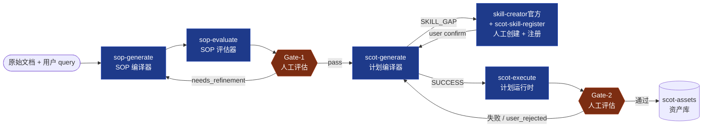
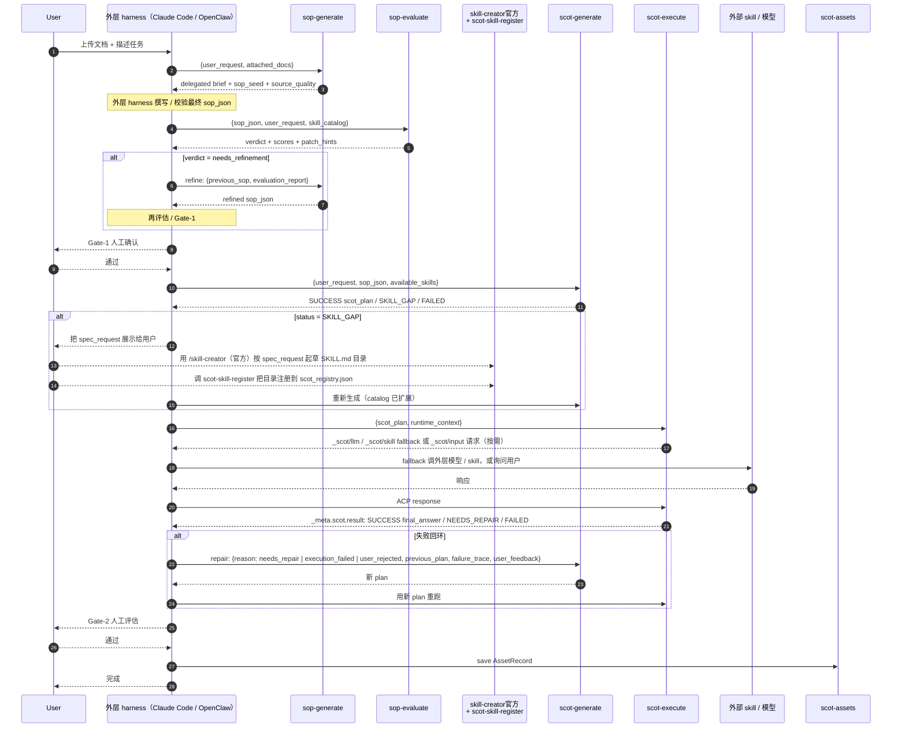
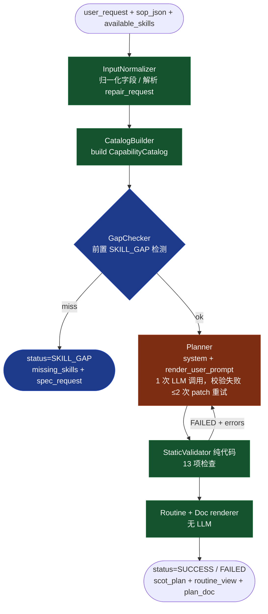
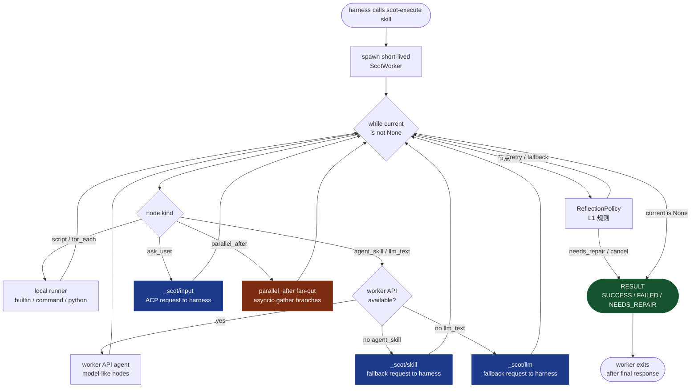
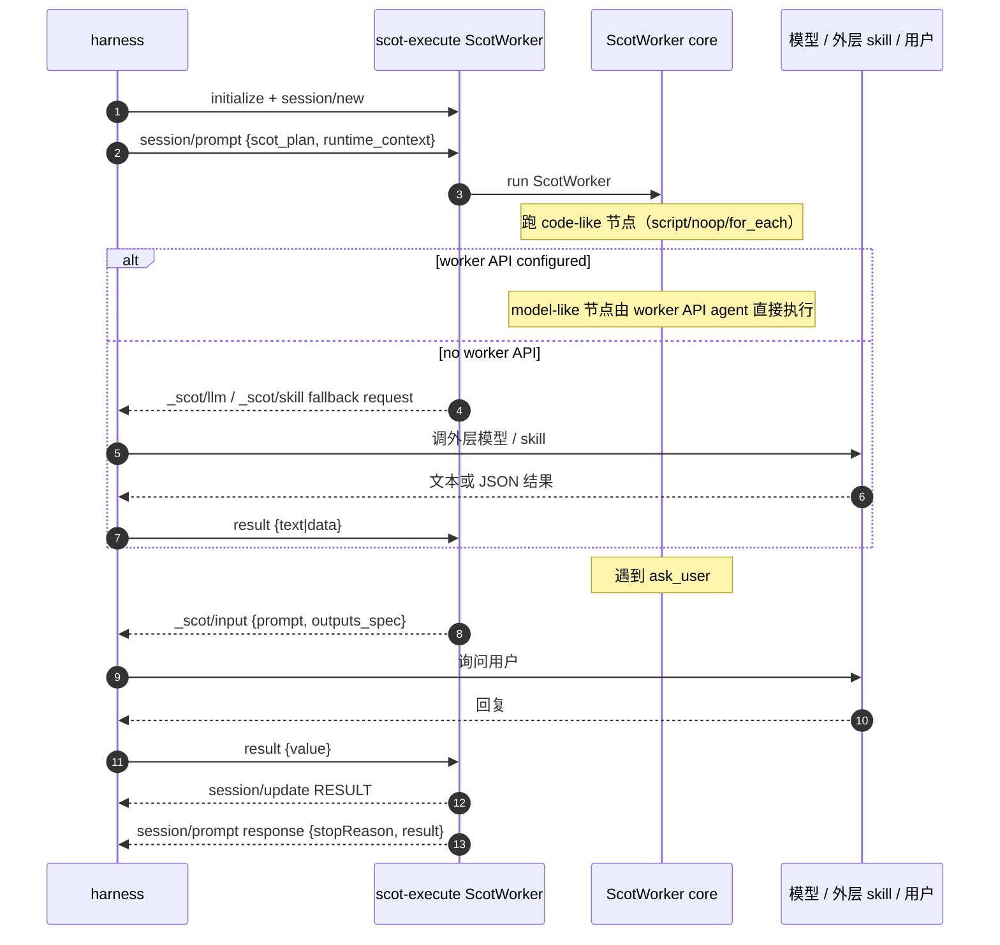

# SCoT Skills

Agent-Skills / 多 harness 侧的 SCOT 工作流 skill 套件，以及配套的协议层与适配器。
这份代码是一个**完全独立的 SCOT skill 包**：安装到目标 `<skills_home>` 后即可被
Claude Code、OpenClaw 或兼容 harness 识别，不依赖任何其他仓库。

---

## 1. 总览：四主线 + 两外围工具的编排流程



| Skill | 角色 | 关键特性 |
|-------|------|---------|
| **sop-generate** | 从文档 + query 抽取结构化 SOP JSON | init / refine 双模式；brief 含 `source_quality` 策略；流程图输入会输出 `sop_flow_graph_context.json` sidecar |
| **sop-evaluate** | 给 SOP 打分 + 出整改建议 | 两步 one-shot：规则评估产 reflection prompt，外层 harness 跑 LLM 反思后 merge；检测 noisy flow steps、历史案例硬编码、抽象不可执行步骤、缺输入、transition 断链 + 机器可消费的 `patch_hints` |
| **scot-trace2sop** | 从历史执行轨迹（trace）反向萃取结构化 SOP JSON | sop-generate 的"轨迹来源"版；node_signals + LLM 步骤合成 + 值抽象；产物可直接喂 sop-evaluate / scot-generate |
| **scot-sop-merge** | 把多份 SOP 合并成一棵分支树 SOP | 跨源步骤规则预聚类（CJK 分词 + Jaccard）+ LLM 对齐；summary / rich 双模式；校验拓扑可达 + alignment 覆盖 |
| **scot-generate** | 把 SOP 编译成 SCOT Plan JSON | 接收 `sop_json` + 可选 `flow_graph_context`；前置 `SKILL_GAP` 检测；统一 `repair_request` 通道 |
| **skill-creator**（外围，Anthropic 官方版） | 人工交互式创建新 skill 来填 catalog 缺口 | 含 evals / 浏览器 viewer / agents 子目录；不在 SCOT 自动闭环里 |
| **scot-skill-register**（外围） | 把已写好的 SKILL.md 目录原子注册到 `scot_registry.json` | 90 行纯代码；O_EXCL 文件锁 + atomic rename；不调 LLM |
| **scot-execute** | 按节点 dispatch 执行 plan | v4.0 ScotWorker 状态机：code-like 节点本地执行；model-like 节点默认由轻量 worker API agent 执行；无 API 时才通过 ACP/MCP `_scot/*` fallback 给 harness；支持 `parallel_after` 并发 |

**编排在 harness 外圈**：8 个 skill（6 主线 + 2 外围）都是无状态单职责，由
Claude Code / OpenClaw 主对话驱动顺序、人工 gate、记账对比。完整指南见
[`docs/orchestration_playbook.md`](docs/orchestration_playbook.md)，参考实现见
[`samples/orchestrate_full_workflow.py`](samples/orchestrate_full_workflow.py)。

所有 skill 通过 **plan_schema** + **ref_expr** + **condition_expr** 三份协议契约通信，
都住在 `scot-shared/`。

## 2. 仓库结构

```text
scot-skills/
├── scot-shared/                   # 跨 skill 协议层（自包含，无外部依赖）
│   ├── plan_schema.py             #   Pydantic：Plan / Node / Transition
│   ├── ref_expr.py                #   $input / $memory / $step / $output 解析
│   ├── condition_expr.py          #   transition.conditions 求值器
│   ├── skill_md_parser.py         #   SKILL.md frontmatter → input/output schema
│   ├── document_ingestion.py      #   txt/pdf/docx/html 读取（sop-generate 用）
│   ├── doc_flow_graph.py          #   mxGraph / SVG / arrow-text 流程图抽取
│   ├── adapters.py                #   SkillInvoker / LLMProvider Protocol
│   ├── assets.py                  #   scot-assets 资产库：save / lookup
│   ├── version.py                 #   SHARED_API_VERSION + 兼容检查
│   └── docs/invocation.md         #   .scot-env.json 调用约定
│
├── sop-generate/                  # SOP 编译器（文档 → sop_json）
│   ├── SKILL.md
│   ├── scripts/
│   │   ├── input_normalizer.py    #   归一化 user_request / docs / refine seed
│   │   ├── doc_grounder.py        #   docs → grounded constraints + flow context + SOP seed
│   │   ├── sop_summary.py         #   SOP JSON schema / validator / fallback builder
│   │   └── generate.py            #   主管线（init / refine 双模式）
│   └── references/sop_schema.md
│
├── sop-evaluate/                  # SOP 自动评估器
│   ├── SKILL.md
│   ├── scripts/evaluate.py        #   rule_pass + reflection merge helpers
│   └── references/dimensions.md   #   五维评分标准
│
├── scot-trace2sop/                # 执行轨迹 → SOP（sop-generate 的轨迹来源版）
│   ├── SKILL.md
│   ├── scripts/                   #   trace_parser / node_signals / sop_builder /
│   │                              #   llm_step_synthesizer / value_abstractor / sop_projector
│   ├── resources/value_abstraction_rules.json
│   └── references/sop_schema.md
│
├── scot-sop-merge/                # 多份 SOP → 一棵分支树 SOP
│   ├── SKILL.md
│   ├── scripts/                   #   sop_loader / step_aligner / summary_merge /
│   │                              #   merge_builder / merge_packager / merge.py 入口
│   └── references/merge_schema.md
│
├── skill-creator/                 # ⭐ Anthropic 官方 skill-creator（人工交互）
│   ├── SKILL.md                   #   含 evals / agents / eval-viewer 等子目录
│   ├── agents/  references/  scripts/  eval-viewer/  assets/
│
├── scot-skill-register/           # SKILL.md 目录 → scot_registry.json 原子追加
│   ├── SKILL.md
│   └── scripts/register.py        #   90 行纯代码；O_EXCL 锁 + atomic rename
│
├── scot-generate/                 # 计划编译器（sop_json → SCOT Plan JSON）
│   ├── SKILL.md
│   ├── scripts/
│   │   ├── input_normalizer.py    #   归一化 user_request / sop_json / repair_request
│   │   ├── catalog_builder.py     #   build CapabilityCatalog
│   │   ├── gap_checker.py         #   前置 SKILL_GAP 检测，命中即跳过 Planner
│   │   ├── planner.py             #   LLM 调用 + 校验失败 patch 重试 ≤2 次
│   │   ├── static_validator.py    #   纯代码 plan validator（13 项检查）
│   │   ├── routine_renderer.py    #   plan → routine_view
│   │   ├── doc_renderer.py        #   plan → plan_doc Markdown
│   │   ├── skill_gap.py           #   ask_user 兜底（保留作为 fallback）
│   │   ├── generate.py            #   主管线
│   │   └── validate_plan.py       #   delegated 模式纯代码校验
│   └── references/                #   plan_schema / ref_expr / routine_view / prompts
│
├── scot-execute/                  # 计划运行时
│   ├── SKILL.md
│   ├── scripts/
│   │   ├── worker.py              #   ScotWorker 主循环 + 6 个状态机助手
│   │   ├── working_memory.py
│   │   ├── transition_engine.py
│   │   ├── usage_meter.py         #   只记账（LLM 次数 / token / 节点 / 墙钟），不强约束
│   │   ├── reflection_policy.py   #   L1 规则 → L3 NEEDS_REPAIR
│   │   ├── trace_recorder.py
│   │   ├── runner.py              #   scot_execute() 高层入口
│   │   ├── worker_bridge.py       #   worker-side bridge interface + mock
│   │   └── acp_agent.py           #   ScotWorker ACP/MCP-facing bridge
│   └── references/                #   node_kinds / acp_protocol / plan_schema
│
├── scot-adapters/common/          # harness profile contract
├── scot-adapters/claude_code/     # Claude Code adapter（也是 OpenClaw 共享底座）
│   ├── registry.py
│   ├── skill_invoker.py
│   ├── builtin_tools.py
│   ├── scan_skills.py             #   安装期扫描 SKILL.md 注册到 registry
│   ├── healthcheck.py
│   ├── write_manifest.py          #   写出 .scot-env.json，含各 skill 的 runner path
│   ├── run_generate.py / run_execute.py
│   ├── run_sop_generate.py / run_sop_evaluate.py / run_skill_register.py
│   └── run_trace2sop.py / run_sop_merge.py
├── scot-adapters/openclaw/        # 薄壳，共享 claude_code 底座
│   └── run_*.py（7 个业务 runner shim；scan_skills 共享 claude_code）
│
├── tools/                         # 仓库维护脚本（不是 user-facing 入口）
│   └── bump_version.py            #   version 字段 + pyproject 同步 + CI 守护
│
├── tests/                         # pytest 回归用例
│   ├── fixtures/
│   ├── _skill_loader.py           #   按 skill 隔离的 importlib loader
│   └── test_*.py                  # plan/ref/condition/worker/e2e/sop/skill_creator/assets/...
├── evals/                         # fixture + benchmark 工作区
│   ├── scot_complex/              #   dense all-node / topology fixture
│   ├── scot_node_type_matrix/     #   script + prompt-only skill 节点类型矩阵
│   └── claude_skill_bench/        #   SCOT worker API vs natural-language big skill harness
│
├── docs/
│   ├── orchestration_playbook.md  #   ⭐ 五步流程编排指南
│   ├── install_windows.md         #   Windows PowerShell 安装详解
│   ├── scot_leadership_brief.md   #   面向集成方 / 领导的机制说明
│   └── skill_creator_eval_report.md  # SKILL.md A/B eval 方法论与结果
├── samples/
│   ├── orchestrate_full_workflow.py  #   参考 orchestrator
│   └── docs/                      #   示例文档
├── requirements.txt                 # single dependency entry point
└── install.sh                     # 安装到 ~/.claude/skills/
```

## 3. 端到端协作时序



## 4. scot-generate 输入契约

scot-generate 不读原始文档 —— 抽取 SOP 是 `sop-generate` 的职责。
本节描述 v4.0 的输入 payload 契约。

### 输入 payload

```json
{
  "user_request": "...",
  "sop_json": { "name": "...", "sopSteps": [...] },
  "flow_graph_context_path": "<optional sop_flow_graph_context.json>",
  "conversation_context": "...",
  "available_skills": [...],
  "mode": "compile" | "repair",
  "repair_request": {
    "reason": "needs_repair | user_rejected | execution_failed",
    "previous_plan": {...},
    "previous_sop": {...},
    "failure_trace": {...},
    "structural_errors": [...],
    "user_feedback": "...",
    "repair_hints": [...],
    "original_request": "..."
  }
}
```

### 内部管线



### 三种 repair reason

| reason | 触发 | planner 重点 |
|--------|------|--------------|
| `needs_repair` | scot-execute 返回 NEEDS_REPAIR | 修结构错误（structural_errors），保留无关节点 |
| `execution_failed` | 计划跑完但 trace 显示失败 | 看 failure_trace 找根因节点，补救（加 fetch / 改条件） |
| `user_rejected` | 人工在 Gate-2 拒绝 | 把 user_feedback 当成主要指令，即使结构合法也要改 |

## 5. scot-execute v4.0 内部架构（ScotWorker + worker API agent）

`scot-execute` 的优化后形态是：skill 调用时启动一个短生命周期
**ScotWorker 状态机**，执行结束后自动退出。worker 是 `scot-execute` 的内部
执行层，不是用户需要单独调用的外部 skill。

执行边界分成两类：

- **code-like 节点**：`script`、`noop`、`for_each`，以及 SKILL.md
  frontmatter 声明 `scripts:` 的 skill。它们由 worker 在本地进程内执行，
  通过 builtin / command / python runner 得到结构化输出。
- **model-like 节点**：`llm_text` 和 prompt-only `agent_skill`。默认由
  SCOT worker API agent 调轻量模型执行。prompt-only skill 会把对应
  `SKILL.md`、input/output schema 和节点输入送给 worker agent，要求它只返回
  schema 合法 JSON。

ACP / MCP 不再是默认逐节点执行路径，而是 **host adapter + fallback**：
没有 worker API、或设置 `SCOT_WORKER_API=0` 时，model-like 节点才通过
`_scot/llm` / `_scot/skill` 交给外层 harness；`ask_user` 始终通过
`_scot/input` 交给外层。当前不保留 file bridge fallback，也不依赖 MCP
sampling。



### dispatch 节点速查（v4.0 合法 kind）

| kind | 在 ScotWorker 内执行 | 外部请求 |
|------|---------------|--------|
| `noop` | ✅ | ❌ |
| `script`（builtin / command / local python runner；含带 `scripts:` 的 SKILL.md） | ✅ in-process | ❌ |
| `for_each` | 迭代分发到 template kind | 看 template kind |
| `agent_skill`（prompt-only SKILL.md） | ✅ worker API agent（默认，有 API 时） | ✅ 未配置 API 时 `_scot/skill` |
| `llm_text` | ✅ worker API agent（默认，有 API 时） | ✅ 未配置 API 时 `_scot/llm` |
| `ask_user` | ❌ | ✅ `_scot/input` |

v4.0 已彻底删除老 `skill` / `tool` / `prompt_skill` kind —— plan_schema
在 parse 阶段直接拒绝。判定原则：**code-like 节点本地跑；model-like 节点
默认由轻量 worker API agent 跑；只有没有 API 时才麻烦外层 harness**。这是
SCOT 性能优势的核心 —— 配置 worker API 后，本地 `script` + 3 个 LLM 推理的
计划通常不产生 LLM ACP/MCP 往返；未配置 API 时也只产生 3 次 fallback 往返而
不是把整张图交给外层模型自由解释。

### ACP extension requests



ScotWorker ACP 入口：

```bash
<venv python> <run_execute.py> [--registry scot_registry.json]
```

完整 ACP 协议契约（握手、`session/prompt`、`_scot/*` 扩展、`$/cancelRequest`
语义、`_meta.scot` 字段保留约定）见
[`scot-execute/references/acp_protocol.md`](scot-execute/references/acp_protocol.md)。

### parallel_after / join_at（v4.0 新增）

需要并发跑多路独立采集时，加一个 `kind=noop` 的 fan-out 节点：

```jsonc
{"id": "fanout", "kind": "noop",
 "policy": {"parallel_fail": "fail_fast"},
 "transition": {"parallel_after": ["q_logs", "q_metrics", "q_alarms"],
                "join_at": "summarize"}}
```

约束（`static_validator` 拒掉的情况）：parallel_after 不能和 next_on_success
共存；分支必须唯一汇合到 join_at；分支间写的 `$memory.<key>` 必须互斥；
分支内不能再嵌套 parallel_after（v4.0 再说）。`policy.parallel_fail` 选
`fail_fast`（默认）或 `best_effort`。

## 6. SCOT / SOP Asset Bundle

`scot-generate` 跑完会**自动**在 `<skills_home>/.scot-assets/bundles/<asset_id>/`
落一个 **SCOT Asset Bundle**；`validate_plan` SUCCESS 时把 plan 用到的
scripts / skill_md 拷进去 + 写 manifest；`scot-execute` 每次跑会往
`reports/runs/<YYYYMMDD-HHMMSS-NNN>/` 追加一份 result + trace +
runtime_context；`scot-generate(mode=repair)` 会把旧版 plan 推进
`plan_history/`。bundle 自包含、可搬运、mutable on reuse。

```
.scot-assets/
├── bundles/<asset_id>/
│   ├── scot_plan.json                  # validated, locked
│   ├── scot_plan.source.json           # planner agent 第一版输出
│   ├── asset_manifest.json + .sha256
│   ├── plan_history/                   # repair 留底
│   ├── catalog/scot_registry.json      # asset-local，相对路径
│   ├── scripts/<tool_name>/...         # 复制进 bundle 的脚本
│   ├── skills/<name>/                  # 完整 SKILL.md 包
│   ├── inputs/{request,sop}.json + sources/
│   └── reports/
│       ├── planning/{brief, sop_evaluate, validate_plan}.json
│       └── runs/<ts>/{result, trace, runtime_context}.json
└── sop-bundles/<asset_id>/
    ├── sop.json                        # canonical (我们用)
    ├── sop_kc.json                     # knowledge-center 视图
    ├── sop_envelope.json + sop_summary.md
    ├── inputs/{request.json, sources/}
    └── reports/{validate_sop.json, sop_evaluate/{rule_pass,reflection,final}.json}
```

**复用**：用户说"用这个 bundle 帮我诊断 X"时，直接用当前 harness 的
scot-execute 通道跑 `<bundle>/scot_plan.json`，registry 指向
`<bundle>/catalog/scot_registry.json` —— Claude Code 走 MCP tool，
OpenClaw / ACP-native custom harness 走 ACP，跳过整条 sop-generate / sop-evaluate /
scot-generate 链。详见 `scot-execute/SKILL.md` 的"复用已有 SCOT Asset Bundle"段。

`scot-shared/assets.py` 暴露 `Bundle` / `SopBundle` 句柄 +
`create_bundle` / `find_bundle_root` / `bundle_skill_artifacts` /
`build_manifest` 等 helper —— 都是 bundle 路径的工具；没有独立的
"查老 plan"接口，因为 bundle 目录就是查找单位。

## 7. 安装

```bash
./install.sh                          # 拷贝 9 个目录到 ~/.claude/skills/
./install.sh --link                   # 软链（开发调试）
./install.sh --with-mcp               # 同时注册 Claude Code 的 scot MCP server
./install.sh --target /custom         # 自定义目标
./install.sh --harness openclaw       # 装到 ~/.openclaw/skills/
./install.sh --minimal                # 只装 core 依赖；txt/html/docx 可用，PDF 需 pypdf
./install.sh --no-venv                # 跳过 venv 创建
./install.sh --clean                  # 装之前清掉 target 里的旧 SCOT 产物（venv 保留）
./install.sh --uninstall              # 清理
```

Windows PowerShell 5+:

```powershell
.\install.ps1                         # copy mode, target defaults to ~/.claude/skills
.\install.ps1 -Link                   # symlink mode; needs Developer Mode or Administrator
.\install.ps1 -Harness openclaw       # target defaults to ~/.openclaw/skills
.\install.ps1 -Target C:\scot-skills  # custom install dir
.\install.ps1 -Clean                  # scrub pre-existing SCOT files before install
```

Windows 端**完整指南**（含执行策略、Python PATH、常见报错处理）见
[`docs/install_windows.md`](docs/install_windows.md)。

> **升级 / 重装注意**：install.sh 默认只 `rm -rf` 当前 8 个 DIRS 目录，
> **不会**碰旧版本可能留在 target 顶层的杂散文件（v4 时代的 `llm_provider.py`、
> `run_evaluate.py` 等）。如果你**从旧版本升级**或 import 时怀疑有幽灵文件，
> 加 `--clean` / `-Clean` 装一次：扫一遍 target，按 SCOT 命名 pattern
> （`scot-*` / `sop-*` / `skill-creator` / `scripts` / `scot_registry.json` /
> `.scot-env.json` / `scot_sample_plan.json` / `llm_provider.py` /
> `run_evaluate.py` / `run_*.py` / `*.pyc`）清掉再装。`.scot-venv/` 不动。

`install.sh` 会建一个 `<target>/.scot-venv/`，写 `<target>/.scot-env.json`
记录所有绝对路径、registry、harness profile 和 execute transport。manifest
现在包含 7 个 runner key（`scot_generate` / `scot_execute` /
`scot_mcp_server` / `sop_generate` / `sop_evaluate` /
`scot_skill_register` / `scan_skills`）。详见 `scot-shared/docs/invocation.md`。

支持的 harness：

| `--harness` | 默认 target | adapter 目录 | 说明 |
|-------------|------------|--------------|------|
| `claude_code`（默认） | `~/.claude/skills` | [scot-adapters/claude_code/](scot-adapters/claude_code/) | Claude Code |
| `openclaw` | `~/.openclaw/skills` | [scot-adapters/openclaw/](scot-adapters/openclaw/) | [OpenClaw](https://github.com/openclaw/openclaw) |

OpenClaw adapter 是薄壳，共享所有 generation / execution / SOP 逻辑；只在 profile
默认值和 delegated-mode prompt 的 harness 名上有差异。

### 配置 SCOT worker API agent

`scot-execute` 默认会尝试读取 worker API 配置。配置成功后，`llm_text` 和
prompt-only `agent_skill` 都由轻量 worker model 在 ScotWorker 内执行；没有配置
时自动走 ACP/MCP fallback。

推荐配置文件：

```json
// ~/.config/scot-skills/worker.json
{
  "api_key_file": "~/.config/scot-skills/worker.key",
  "base_url": "https://api.openai.com/v1",
  "model": "gpt-4o-mini",
  "skill_model": "gpt-4o-mini",
  "auth_header": "authorization",
  "max_token_field": "max_completion_tokens"
}
```

也可以只用环境变量：

```bash
export SCOT_WORKER_API_KEY=...
export SCOT_WORKER_BASE_URL=https://api.openai.com/v1
export SCOT_WORKER_MODEL=gpt-4o-mini
export SCOT_WORKER_SKILL_MODEL=gpt-4o-mini
export SCOT_WORKER_AUTH_HEADER=authorization
export SCOT_WORKER_MAX_TOKEN_FIELD=max_completion_tokens
```

配置读取顺序：`SCOT_WORKER_CONFIG` 指定的 JSON 文件，否则
`~/.config/scot-skills/worker.json`；API key 优先读环境变量，其次读
`api_key_file` / `SCOT_WORKER_API_KEY_FILE`，最后尝试
`~/.config/scot-skills/worker.key` 和 `~/.config/scot-skills/xiaomi.key`。

兼容别名包括 `SCOT_API_KEY` / `XIAOMI_API_KEY` / `MIMO_API_KEY` /
`OPENAI_API_KEY`，以及对应的 `*_BASE_URL`、`*_MODEL`、`*_AUTH_HEADER`。
需要强制外层 harness 执行 model-like 节点时设置：

```bash
export SCOT_WORKER_API=0
```

安装后在 harness 里直接：

```
帮我用 sop-generate 把 docs/runbook.pdf 整理成可执行流程
```

外层 harness 按 [`docs/orchestration_playbook.md`](docs/orchestration_playbook.md)
串接 4 个主线 skill：sop-generate → sop-evaluate → Gate-1 → scot-generate
→ scot-execute → Gate-2 → 保存资产；如果 scot-generate 返回 `SKILL_GAP`，
再进入 2 个外围 skill：skill-creator 起草新 SKILL.md，scot-skill-register
把它原子注册到 catalog 后重跑 scot-generate。

## 8. EDDX / HTML 流程图输入（sop-generate）

把 EDDX / draw.io / 类似工具导出为 HTML 后作为 `attached_docs` 传给 sop-generate：

```json
{
  "user_request": "新问题：请按这份诊断流程排查某服务 TPS 下降",
  "attached_docs": [{"path": "./docs/diagnosis-flow.html"}]
}
```

`doc_flow_graph` 会按优先级抽取：

- 显式嵌入的 `scot-flow-graph` JSON
- EDDX / draw.io 的 `mxGraphModel` / `mxCell` 节点和边
- 压缩在 `<mxfile><diagram>` 中的 mxGraph 数据
- EDDX / Edraw 导出的 SVG shape + connector 几何关系
- HTML 可见文本里的 `A -->|条件| B`、`A -- 条件 --> B`、`A -> B`

抽取成功后，图节点变成 SOP 步骤候选，图边写入 step `transitions`，并保留兼容性的
children 分支说明。`sop-generate` 还会生成稳定 sidecar：
`sop_flow_graph_context.json`，其中包含 entry/terminal nodes、components、
warnings 和 capability lanes。像 `API`、`能力`、`eOps`、`shell`、`awk`、
`access.log` 这类节点会进入 `metadata.capability_requirements`，不混入主诊断步骤。

下游 scot-generate 可接收：

```json
{
  "user_request": "...",
  "sop_json": { "...": "..." },
  "flow_graph_context_path": "<save_dir>/sop_flow_graph_context.json"
}
```

规划时优先使用 `sopSteps[].transitions` / `flow_graph_context` 生成
`transition.conditions`，再退回 children/prose 推断。

`sop-generate` 的 brief/report 还会给出 `source_quality`：
`structured_flow`、`numbered_runbook`、`historical_case`、`prose_notes`、
`weak_text`、`visual_only`。外层 harness 按这个质量类型选择策略：流程图优先保
拓扑，编号 runbook 保顺序，历史案例必须抽象化，弱文本/纯视觉材料需要显式列
待确认问题。

## 9. 共享协议契约

### Plan Schema（v4.0，详见 `scot-shared/plan_schema.py`）

```jsonc
{
  "version": "4.0",
  "plan_id": "plan_abc123",
  "entry": "n1",
  "memory_init": {"device_id": "BJ-CORE-01"},
  "meta": {
    "goal": "...",
    "success_criteria": ["..."],
    "budget": {
      "max_llm_calls":    20,
      "max_total_tokens": 50000,
      "max_wall_time_ms": 120000,
      "max_plan_steps":   200
    },
    "reflection": {
      "enable_l2": false,
      "l1_rules": {"timeout": "retry"}
    }
  },
  "nodes": [
    {
      "id": "n1",
      "kind": "script | agent_skill | llm_text | ask_user | noop | for_each",
      "name": "<catalog 名；llm_text/ask_user/noop/for_each 可空>",
      "purpose": "...",
      "inputs":  {"<param>": "$memory.x | $input.y | $step.n0.z | <literal>"},
      "outputs": {"<result_key>": "$memory.target | $output.final_answer"},
      "transition": {
        "next_on_success": "n2",
        "next_on_fail":    "n_fail",
        "conditions": [{"expr": "$memory.x > 0", "goto": "n3", "priority": 1}],
        "parallel_after": ["n2", "n3", "n4"],   // v4.0 fan-out
        "join_at": "n5",                          // v4.0 配合 parallel_after
        "end": false
      },
      "policy": {
        "timeout_ms": 5000, "max_retry": 1, "on_fail": "abort",
        "parallel_fail": "fail_fast"             // v4.0
      },
      "prompt_template": "...",
      "model_hint": "fast | deep"
    }
  ]
}
```

### SOP JSON Schema（详见 `sop-generate/references/sop_schema.md`）

```jsonc
{
  "name": "string",
  "metadata": {
    "source_type": "flow_graph",
    "flow_graph_context_path": "<optional sidecar path>",
    "flow_graph_summary": {"node_count": 0, "edge_count": 0},
    "capability_requirements": []
  },
  "sopSteps": [
    {
      "content": "step content",
      "order": 1,                  // 同级从 1 连续递增
      "metadata": {"source_node_id": "shape1", "lane": "diagnostic"},
      "transitions": [             // 可选；流程图边 / 分支条件
        {"condition": "是", "target_step_order": 2,
         "target_node_id": "shape2", "target_content": "next step"}
      ],
      "children": [                // 可选；最多一层
        {"content": "child", "order": 1}
      ]
    }
  ]
}
```

### sop-evaluate 输出 Schema

```jsonc
{
  "status": "SUCCESS",
  "verdict": "pass | needs_refinement | reject",
  "scores": {
    "completeness": 4.5,
    "executability": 3.0,
    "logical_consistency": 4.0,
    "query_alignment": 4.5,
    "ambiguity": 2.0              // 反向：低分代表好
  },
  "issues": [
    {"severity": "high|medium|low",
     "step": 3,
     "type": "ambiguous | missing_prerequisite | unreachable | not_executable | misaligned | redundant | case_specific",
     "message": "...",
     "suggestion": "..."}
  ],
  "patch_hints": [
    {"op": "add_step | modify_step | remove_step | reorder",
     "step_ref": "<order or content>",
     "content": "..."}
  ],
  "summary_for_human": "<中文 markdown，含：适合进入下一步 / 需要再做一轮语义精修 / 建议重新抽取>"
}
```

### 引用语法（`scot-shared/ref_expr.py`）

| 引用 | 解析自 |
|------|-------|
| `$input.user_request` | `runtime_context.user_request` |
| `$input.<node_id>.<field>` | `runtime_context.user_inputs[<node_id>]` |
| `$memory.x.y[0]` | WorkingMemory |
| `$step.n1.field` | 节点 n1 的 outputs |
| `$output.final_answer` | output_buf |

> ⚠️ 不支持算术：`"$input.t - 300000"` 解析失败 → None。要算就插一个
> `kind=script name=scot-deterministic-script` 节点。

### Condition 表达式（`scot-shared/condition_expr.py`）

```
cond := or_expr
or_expr := and_expr ('or' and_expr)*
and_expr := not_expr ('and' not_expr)*
not_expr := 'not' not_expr | atom
atom := '(' cond ')' | predicate
predicate := value (cmp value | 'in' value | 'contains' value | 'exists' | 'empty')?
value := ref | str | num | 'true' | 'false' | 'null' | '[' value (',' value)* ']'
cmp := == != > >= < <=
```

例：`$memory.alarm_count > 0`、`$memory.alarms exists and not $memory.alarms empty`。

## 10. 测试

```bash
cd scot-skills
python -m venv .venv
./.venv/bin/pip install -r requirements.txt
./.venv/bin/python -m pytest tests/
```

当前回归以 `./.venv/bin/python -m pytest tests/` 实际输出为准，覆盖：

- plan schema / ref expr / condition expr
- ScotWorker（worker API agent 路径、`_scot/llm` / `_scot/skill` /
  `_scot/input` fallback 往返 + `$/cancelRequest` 路径）
- 并行节点（fail_fast / best_effort、并发执行验证、validator 6 项检查）
- worker（含 NEEDS_REPAIR、reflection、cancel 语义）
- ScotWorker 端到端（真子进程 + JSON-RPC over stdio）
- static validator（13 项 + 6 项并行检查）
- document ingestion（含 flow_graph 抽取、SVG 中文断词清理）
- **sop-generate**（init / refine、source quality、validation 失败、flow graph sidecar）
- **sop-evaluate**（rule_pass + 强制 LLM reflection merge、pass / reject / misaligned、noisy flow / case-specific / 抽象不可执行 / 缺输入检测、patch_hints 生成）
- **scot-skill-register**（注册新 skill 到 scot_registry.json，O_EXCL 锁 + 幂等）
- **官方 skill-creator** 安装结构 smoke check（frontmatter / agents / eval-viewer 都在）
- **gap_checker**（catalog 覆盖判定）
- **assets**（save / lookup / catalog 兼容过滤）
- harness profile、install manifest（含 6 个 runner）
- **node type matrix**（script `argv` / shell command / Python function /
  builtin deterministic tool、parallel fan-out、for_each、timeout、rollback、
  prompt-only skill schema）
- **Scientific50 / JumpControl50 benchmark fixtures**：受控生成 50 条
  SCOT worker API vs Big Skill 对比用例；Big Skill 基线使用自然语言
  routine/SOP 风格描述，不直接暴露 SCOT JSON，用来衡量状态机对复杂跳转的
  控制准确率、时延和 token。

`tests/_skill_loader.py` 用 importlib 隔离不同 skill 间的同名模块（如
`input_normalizer.py`），避免 sys.path 顺序污染。


### 调试 skill / LLM 异常

worker 内任何 `kind=script / agent_skill / llm_text` 节点抛出的异常都会被包装为
`NodeResult(status="failed", raw_error=<完整 traceback>)`。`SCOT_DEBUG=1`
会把 NDJSON 诊断行镜像到 stderr；需要人工可读旧格式时用
`SCOT_DEBUG=text`。

### 大 PDF 输入

`scot-shared/document_ingestion.py` 默认只读取 PDF 前 40 页。需要全量：

```bash
SCOT_PDF_MAX_PAGES=200 ...
```

### Plan 版本兼容

每个 plan **必须**带 `version` 字段（当前 `"4.0"`）；scot-shared 校验主
版本号 —— 同主版本（`4.x`）都能加载；缺 `version` 字段或主版本不匹配
的 plan 直接 `-32602` 拒绝，重新跑 scot-generate 即可
（`scot-shared/version.py::explain_incompatibility`）。

没有跨进程续跑模型，也不会把中间态落给下一次进程调用。ScotWorker
一次跑到底；code-like 节点本地执行，model-like 节点优先由 worker API agent
承接，未配置 API 时通过 ACP/MCP `_scot/llm` / `_scot/skill` fallback，
用户输入通过 `_scot/input` 实时往返。
